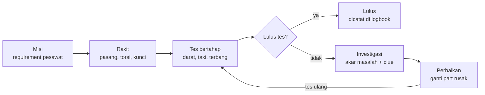
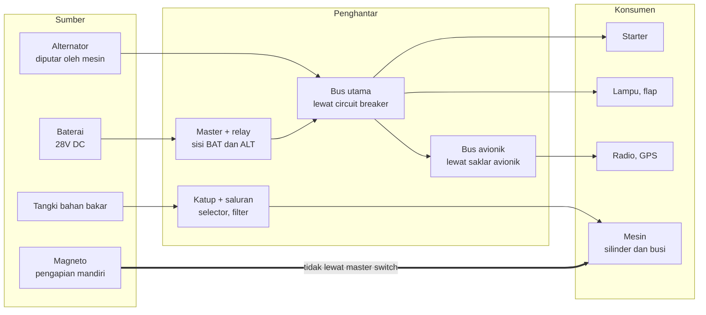

# GDD — AES (Aerospace Engineer Simulator)

19 Oktober 2026 · Kaff

## Visi & konsep

Pemain berperan sebagai engineer yang merakit pesawat dari nol di hanggar, lalu mengujinya. Kegagalan saat tes lahir dari kesalahan perakitan yang nyata, dan pemain belajar dengan melacak penyebabnya. Arahnya simulator edukatif serius seperti Microsoft Flight Simulator, tapi fokusnya di hanggar, bukan di kokpit.

Empat pilar desain:

- **Prosedur nyata.** Urutan pasang, torsi, safety wire, dan inspeksi mengikuti praktik perawatan pesawat, disusun per bab ATA 100.
- **Sistem saling terhubung.** Kelistrikan, bahan bakar, oli, dan pengapian saling bergantung; salah di satu sistem bisa muncul sebagai gejala di sistem lain.
- **Belajar dari gagal, bukan dari kuis.** Tidak ada kuis. Pemain yang penasaran belajar sendiri lewat laporan investigasi dan buku panduan.
- **Visual 3D tembus pandang.** Mode solid, x-ray, wireframe, dan exploded view, dengan part yang muncul dan terpasang satu per satu.

Pembeda dari kompetitor terdekat, Plane Mechanic Simulator: game itu soal merawat pesawat era Perang Dunia II. Kita merakit pesawat modern dari nol, dengan simulasi lintas sistem dan investigasi kegagalan.

## Core loop



Pemain merakit berdasarkan requirement, lalu menguji secara bertahap. Tes yang gagal membuka investigasi, perbaikan, dan tes ulang; tes yang lulus tercatat di logbook.

## Scope MVP

MVP memakai satu pesawat piston ringan bermesin tunggal, kelas Cessna 172, tanpa APU. Kelas ini dipilih karena sistemnya paling sederhana, dan data pesawat aslinya banyak, sehingga bisa dipakai untuk memvalidasi simulasi. Di dalam game, pesawat dan part memakai nama original, bukan merek asli.

Sistem yang masuk MVP:

- **Powerplant**: mesin piston, engine mount, propeller, cowling, knalpot.
- **Pengapian**: magneto dan timing. Magneto menghasilkan listrik sendiri, jadi mesin yang sudah hidup tetap jalan walau master switch mati.
- **Kelistrikan DC 28V**: baterai, master switch, alternator, bus utama, bus avionik, circuit breaker, starter.
- **Bahan bakar dan oli**: saluran, katup, klem, filter, tekanan oli.

Tahapan tes MVP: ground power-up, start mesin dan run-up, taxi, lalu test flight sederhana.

Airframe (badan dan sayap) sudah jadi di MVP, jadi pemain fokus memasang sistem. Platform target pertama adalah browser desktop.

Di luar MVP (lihat Roadmap): APU dan pesawat jet, turboprop, hidrolik, avionik kompleks, akun online.

## Sistem pesawat sebagai resource network

Semua sistem dimodelkan sebagai satu jaringan aliran yang terdiri dari sumber, penghantar, dan konsumen, untuk listrik, bahan bakar, oli, dan pengapian. Dengan begitu, kesalahan di satu sistem bisa muncul sebagai gejala di sistem lain.



Intinya: listrik mati mematikan starter, tapi mesin yang sudah hidup tetap jalan.

Tiap kesalahan rakit mengubah jaringan ini: kabel lupa dipasang memutus jalur, terminal kendor menaikkan hambatan, breaker salah rating putus terlalu cepat. Diagnosis menelusuri jaringan dari gejala ke hulu, misalnya starter mati, lalu bus, relay, sampai kabel master switch yang putus.

Strukturnya sama untuk semua kelas pesawat. APU atau generator jet nanti cukup ditambahkan sebagai sumber baru.

## Perakitan

Urutan pasang dimodelkan sebagai dependency graph: tiap langkah punya prasyarat, dan graf ini disimpan sebagai data, bukan kode. Contoh kasar untuk mesin piston: engine mount ke firewall, mesin dan peredam getaran, saluran bahan bakar dan oli, knalpot, magneto dan timing, kabel, starter dan alternator, kabel kontrol, propeller, cowling, lalu inspeksi dan run-up.

Satu langkah bisa terdiri dari beberapa aksi:

1. **Pasang** part di titik pasangnya.
2. **Kencangkan** dengan nilai torsi yang benar.
3. **Kunci** dengan safety wire atau cotter pin bila diwajibkan.
4. **Sambungkan** kabel, selang, atau kabel kontrol.
5. **Inspeksi** sebelum lanjut ke langkah berikutnya.

Sistem tidak pernah menolak urutan yang salah. Pemain sudah punya handbook step-by-step dan **checklist** (task card) per langkah. Kalau engineer ceroboh dan tidak mengikuti checklist, itu kesalahan engineer, dan akibatnya baru muncul saat tes, seperti di dunia nyata.

Aturan checklist: dicentang sendiri oleh pemain sebagai sign-off, dan mencentang tidak memverifikasi apa pun. Kalau checklist memvalidasi otomatis, defect akan bocor sebelum tes dan inti game hilang.

Aturan logika fisik perakitan (berlaku untuk semua part, diputuskan 19 Oktober 2026):

- **Part yang masih diikat pengencang tidak bisa diangkat.** Selama masih ada mur atau baut yang terpasang, part terkunci. Pemain harus mengendurkan lalu melepas semua pengencangnya dulu. Ini bukan validasi sistem, tapi batasan fisik, sama seperti flange yang tidak cocok dengan pad lain.
- **Mur dipasang sendiri oleh pemain.** Setelah part duduk di pad, ring dan mur dipasang di tiap stud (kencang tangan), baru dikencangkan dengan kunci torsi.
- **Safety wire harus cenderung mengencangkan pengencang** ("Safety wire should always tend to tighten the bolt, nut, or fastener", FAA *Safety Wire*, AFS-850 20-05). Arah lilitan dipilih engineer sendiri dan tidak diperiksa sistem; lilitan yang menarik ke arah mengendur tercatat sebagai defect `noLock` dan baru ketahuan saat tes. Mur yang terikat kawat tidak bisa dilepas atau ditorsi ulang sebelum kawatnya dipotong, dan kawat bekas tidak dipakai ulang (AC 43.13-1B par. 7-38). Safety wire hanya diwajibkan di langkah yang datanya mencantumkan aksi `safetyWire`.
- **Pengencangan dengan kunci torsi memakai interface close-up terpisah**, bukan langsung di scene 3D. Alurnya: mur diputar sampai duduk (run-down), lalu tarikan menaikkan torsi sampai kunci berbunyi klik di nilai setelan dial. Kalau tetap ditarik setelah klik, torsi terus naik (over-torque), seperti kunci torsi tipe klik sungguhan. Interface-nya adalah alat itu sendiri, dalam bentuk hybrid: kunci, mur, dan ayunan gagang dirender 3D dari model asli (kamera lurus di sumbu stud, hanya kunci, mur, stud, dan pad yang ditampilkan), sedangkan skala mikrometer (barrel + thimble) tampil sebagai gambar tajam di kaca pembesar dengan garis penunjuk ke barrel 3D. Hasil ditulis di slip log torsi. Seperti kunci tipe klik asli, tidak ada penunjuk torsi aktual: pemain hanya tahu setelan dan apakah terasa klik. Torsi sebenarnya disimpan diam-diam dan baru berpengaruh saat tes (defect under/over-torque).

Akurasi part dibagi tiga tier. Bentuk boleh disederhanakan, tapi data (ukuran, torsi, jumlah, urutan) harus selalu benar.

| Tier | Contoh part | Akurasi bentuk | Akurasi data |
| --- | --- | --- | --- |
| 1 — Kritis | Blok mesin, silinder, propeller, engine mount, firewall, spar sayap, landing gear | Proporsi dan titik sambung akurat | Penuh |
| 2 — Aksesori | Starter, karburator, magneto, alternator, filter oli, knalpot | Bentuk dikenali, titik pasang akurat | Penuh |
| 3 — Kecil | Baut, mur, ring, klem, kabel, selang | Disederhanakan, ulir cukup tekstur | Penuh |

## Tes & diagnosis kegagalan

Setiap kegagalan tes harus memberi tahu pemain apa yang terjadi, di mana letak salahnya, dan clue untuk memperbaikinya. Alurnya:

1. **Defect registry.** Tiap aksi perakitan yang salah dicatat sebagai defect, dengan jenis dan lokasinya.
2. **Defect mengubah jaringan.** Defect diterjemahkan ke perubahan di resource network (lihat bagian sistem pesawat).
3. **Simulasi deterministik.** Hasil tes yang sama selalu muncul untuk rakitan yang sama, sehingga bisa diputar ulang.
4. **Black box.** Selama tes, RPM, suhu, tekanan oli, tegangan bus, dan aliran bahan bakar direkam.
5. **Laporan investigasi.** Setelah gagal, sistem menelusuri jaringan dari gejala ke hulu sampai menemukan akar masalah.

| Jenis defect | Contoh | Efek di jaringan |
| --- | --- | --- |
| Part tidak terpasang | Kabel master switch lupa disambung | Jalur listrik putus |
| Salah urutan | Cowling dipasang sebelum knalpot dikencangkan | Langkah yang terlewat tercatat tidak selesai |
| Torsi kurang | Terminal kabel kendor | Hambatan naik, tegangan drop |
| Torsi lebih | Baut flange terlalu kencang | Part retak, bocor saat tes |
| Pengunci tidak dipasang | Safety wire baut mesin lupa | Baut lepas karena getaran |
| Salah part | Breaker rating terlalu kecil | Breaker putus saat beban penuh |
| Setelan salah | Timing magneto meleset | Tenaga turun, suhu silinder naik |

Isi laporan investigasi:

- **Kronologi** kejadian, dengan grafik dari black box.
- **Akar masalah**: part mana dan apa salahnya.
- **Dampak lanjutan**: rantai sebab-akibat, misalnya klem selang oli lupa, oli bocor, mesin macet, silinder rusak.
- **Clue perbaikan**: part yang harus dicek atau diganti, dengan link ke halaman handbook.

Part yang rusak akibat kegagalan harus diganti sebelum tes ulang.

Laporan investigasi selalu lengkap di semua mode. Perbedaan mode Trainee dan Certified hanya di handbook: Trainee memberi petunjuk langkah, Certified hanya berfungsi sebagai referensi.

## Buku panduan engineer

Handbook in-game meniru gaya manual perawatan pesawat asli, disusun per bab ATA, supaya pemain sekalian belajar membaca dokumen teknis.

Isinya:

- **Entri part**: fungsi, spesifikasi, nilai torsi, part yang terhubung.
- **Prosedur** step-by-step dengan label WARNING, CAUTION, dan NOTE.
- **Teori**: kenapa sebuah langkah ada, misalnya kenapa magneto harus di-timing.
- **Glosarium** istilah teknis.

Fiturnya:

- **Kontekstual**: sekali tekan dari part yang sedang dipegang, langsung buka halamannya.
- **Unlock bertahap** seiring progres, seperti codex.
- **Pencarian** di sisi client dengan MiniSearch atau Fuse.js.

Aturan arsitektur: handbook tidak ditulis terpisah dari data game. Spesifikasi, torsi, dan prosedur dirender dari JSON yang sama dengan logika perakitan. Yang ditulis manual hanya narasi teori (MDX), ditautkan ke ID part.

## Engineer logbook

Tiap engineer punya logbook yang mencatat pencapaiannya, seperti buku log teknisi pesawat di dunia nyata. MVP memakai profil lokal: beberapa pemain di satu perangkat, masing-masing dengan save dan logbook sendiri.

Isi logbook:

- **Riwayat kerja**: pesawat yang dirakit dan sistem yang dikerjakan.
- **Rekam jejak tes**: jumlah test flight lulus dan gagal.
- **Kasus investigasi**: kegagalan yang berhasil dilacak dan diperbaiki.
- **Kualifikasi** per bab ATA, misalnya Powerplant Rated atau Electrical Rated.
- **Bookmark** halaman handbook dan **catatan pribadi**.

Pencapaian dihitung dari event log, bukan dari counter manual. Contoh event: `AssemblyStepCompleted`, `TestFlightFailed`, `RootCauseFixed`. Log bersifat append-only dan disimpan di IndexedDB.

Struktur datanya dibuat siap sinkron sejak awal: ID memakai UUID, tiap event punya timestamp dan profileId. Pindah ke akun online nanti cukup menambah lapisan sync ke server, tanpa migrasi data lokal.

Progres dicatat sesuai mode yang dipilih engineer. Tiap event menyimpan mode-nya (Trainee atau Certified), dan logbook menampilkan pencapaian serta kualifikasi per mode secara terpisah.

## Arah visual UI

Diputuskan 19 Oktober 2026 lewat brainstorming. Mockup ada di canvas "AES — UI Mockup", baris "Arah 2".

- **Dua mode UI.** Mode dokumen: task card, handbook, laporan investigasi, dan logbook berupa kertas cetak di meja kerja; kamera mendekat lalu kertas tampil rata dan mudah dibaca. Mode rakit: fokus ke model 3D, informasi menempel langsung di part, HUD minimal.
- **Implementasi dokumen.** Animasi kamera ke clipboard, lalu kertasnya overlay React bergaya kertas, supaya teks tajam dan aksesibel. Scene 3D diredupkan selama mode dokumen. Versi pertama (20 Oktober 2026): task card di meja kerja, baris checklist diturunkan dari aksi langkah di data konten, dicentang dan diparaf sendiri, lalu ditandatangani. Task card yang sudah ditandatangani terkunci, dan tag langkahnya berubah hijau.
- **Material: kertas cetak.** Font mesin ketik untuk teks cetak, tulisan tangan untuk isian engineer, cap tinta untuk sign-off dan inspeksi.
- **Warna kertas per jenis dokumen.** Task card putih, laporan investigasi kuning, logbook bersampul hijau tua.
- **Mode rakit.** Tag inspeksi gantung: kuning untuk langkah aktif, hijau untuk langkah yang sudah di-sign-off (bukan tanda pekerjaan benar). Lensa x-ray cyan sebagai "penglihatan engineer" di area kerja. Alat bersifat diegetic, misalnya dial kunci torsi.
- **Suasana.** Hanggar malam dengan kolam cahaya hangat dari lampu kerja.
- **UI non-diegetic** hanya untuk prompt tombol dan menu pengaturan.
- **Prototipe 3D mode rakit** (artifact "AES Mode Rakit", 19 Oktober 2026) memakai bentuk dasar sebagai placeholder. Aturan interaksi yang sudah diputuskan:
  - Kamera bisa diputar 360° dan dilihat dari bawah mesin, tapi tidak boleh menembus lantai, dinding, atau benda; zoom berhenti di permukaan benda.
  - Highlight benda yang bisa di-action berwarna biru.
  - Lensa x-ray hanya membuka mesin yang sedang dikerjakan, menampilkan bagian dalam bergaya cutaway, dan tidak menembus aset lain.
  - Saat lensa x-ray aktif, hanya komponen dalam mesin yang bisa di-hover dan dipilih.
  - Kunci torsi berupa alat 3D: tergantung di shadow board saat tidak dipakai, berpindah ke titik kerja saat dipakai.
  - Pencahayaan memakai satuan fisik (lumen, lux, falloff kuadrat jarak) dan material PBR sesuai bahan aslinya.
  - Engineer memakai headlamp mekanik (280 lm, nilai output headlamp kerja bersumber; sudut sorot masih placeholder) yang menempel di kepala dan bisa dinyalakan atau dimatikan (H). Area kerja yang membelakangi lampu kerja, seperti pad aksesori di belakang mesin, diterangi headlamp ini, bukan lampu khusus UI.
  - Part Tier 2 diambil dari meja part lalu dipasang ke pad lewat bayangan pemasangan; pad dengan flange yang tidak cocok menolak part.
  - Review visual berikutnya dilakukan setelah aset 3D dari pipeline tersedia.

## Arsitektur teknis

Game dibangun di web dengan TypeScript, dalam monorepo pnpm. Aturan utamanya: logika simulasi terpisah total dari rendering, supaya bisa diuji sendiri dan nanti bisa dijalankan di server atau dipindah ke engine lain.

| Lapisan | Tanggung jawab | Teknologi |
| --- | --- | --- |
| `sim-core` | Resource network, dependency graph perakitan, defect, simulasi tes, diagnosis | TypeScript murni, tanpa dependensi UI, deterministik |
| `content` | Data part, langkah, efek defect, narasi handbook | JSON divalidasi Zod, MDX |
| `renderer` | Scene 3D, mode x-ray, wireframe, exploded view | Three.js lewat React Three Fiber. Sementara tinggal di `apps/game/src/scene`; dipisah jadi paket sendiri saat ada konsumen kedua |
| `app` | UI hanggar, handbook, laporan investigasi, logbook | React + Vite |
| `persistence` | Save, profil lokal, event log | IndexedDB (Dexie) |
| `server` (nanti) | Akun, sinkronisasi logbook | NestJS + PostgreSQL |

Prinsip pengujian: `sim-core` punya unit test, termasuk tes validasi. Contohnya, spesifikasi pesawat kelas C172 dimasukkan ke engine, lalu hasil hitungannya dibandingkan dengan data aslinya. Konten divalidasi skema di CI, jadi data part yang rusak tidak bisa masuk build.

## Pipeline aset 3D

Aset dibuat dengan pipeline hybrid: part kecil dibuat dari kode, part kompleks dari AI image-to-3D lalu dirapikan manual. Aset 3D adalah bottleneck terbesar proyek ini, bukan kodenya.

1. **Tier 3 dan part parametrik** (baut, mur, pipa, bracket, flange) dibuat dengan CadQuery (Python), dimensinya dari standar ukuran nyata.
2. **Tier 1 dan 2** dibuat dengan AI image-to-3D. Jalur yang sudah terbukti (19 Oktober 2026): gambar input, lalu Microsoft TRELLIS.2 lewat Hugging Face Space (gratis, model berlisensi MIT, butuh login Hugging Face untuk kuota GPU). Meshy paket Free tidak bisa mengunduh model 3D, hanya gambar.
3. **Rapikan otomatis di asset pipeline**: simplifikasi bentuk, atlas UV baru, bake ulang tekstur, titik asal di muka dudukan, skala ke meter. Anggaran Tier 2: maksimal 30.000 segitiga dan tekstur 1024 px per part. Koreksi manual di Blender hanya untuk part yang titik sambungnya harus presisi (Tier 1).
4. **Ekspor** ke GLB dengan kompresi Draco, plus LOD untuk part besar.
5. **Metadata terpisah**: titik pasang, torsi, prasyarat, dan nomor ATA disimpan di JSON. Model 3D hanya kulit, jadi bisa diganti tanpa mengubah logika.

Performa: part yang berulang (baut, ring) dirender dengan instancing, satu geometri untuk ratusan salinan.

## Model data

Empat tipe inti di `sim-core`. Semua konten game adalah instance dari tipe-tipe ini, divalidasi skema saat build. Nilai di contoh ini ilustrasi, bukan data teknis.

```ts
// Part: satu komponen fisik
type Part = {
  id: string;              // "pwr.magneto.left"
  ataChapter: number;      // 74 = Ignition
  tier: 1 | 2 | 3;
  model: string;           // "magneto_l.glb"
  attachPoints: AttachPoint[];
  network?: NetworkRole;   // source | conductor | consumer
};

// Langkah perakitan: simpul di dependency graph
type AssemblyStep = {
  id: string;
  partId: string;
  requires: string[];      // id langkah prasyarat
  actions: Array<
    | { kind: "install" }
    | { kind: "torque"; value: number; unit: "in-lb" }
    | { kind: "safetyWire" }
    | { kind: "connect"; to: string }
    | { kind: "inspect" }
  >;
};

// Defect: kesalahan yang dicatat diam-diam
type Defect = {
  stepId: string;
  kind: "missing" | "wrongOrder" | "underTorque" | "overTorque"
      | "noLock" | "wrongPart" | "misadjusted";
};

// Event: sumber kebenaran untuk logbook
type GameEvent = {
  id: string;              // UUID
  profileId: string;
  mode: "trainee" | "certified";
  at: string;              // ISO timestamp
  type: "AssemblyStepCompleted" | "ChecklistItemSigned"
      | "TestFlightFailed" | "TestFlightPassed" | "RootCauseFixed";
  payload: Record<string, unknown>;
};
```

## Sumber konten & legal

Konten teknis diambil dari sumber publik, dan semua identitas di game dibuat original.

- **Prosedur dan praktik perawatan**: handbook teknisi perawatan pesawat dari FAA, dokumen pemerintah AS yang bebas dipakai.
- **Spesifikasi resmi** (berat, tenaga mesin): Type Certificate Data Sheet dari FAA.
- **Rumus desain dan performa**: buku teks seperti Raymer, *Aircraft Design*, dan Anderson, *Introduction to Flight*.
- **Larangan**: tidak menyalin manual pabrikan seperti Cessna atau Lycoming, dan tidak memakai nama, logo, atau merek pesawat asli.
- **Gambar untuk AI image-to-3D**: hanya foto sendiri, gambar CC0, atau gambar hasil generate sendiri.
- **Lisensi aset AI**: gambar dari Meshy paket Free berlisensi CC BY 4.0, jadi wajib dicantumkan di daftar kredit game. TRELLIS.2 berlisensi MIT. Kredit tiap part dicatat di field `credits` pada spesifikasi Tier 2, supaya halaman kredit bisa dibangun otomatis. Sebelum rilis komersial, cek ulang lisensi semua sumber.

Status lisensi tiap sumber perlu dicek ulang sebelum konten pertama ditulis.

## Roadmap & fitur yang ditunda

Fitur di bawah ini sengaja tidak masuk MVP dan dicatat di sini supaya tidak terlupa. Tiap fitur dibahas dulu sebelum dikerjakan.

| Fitur | Catatan |
| --- | --- |
| APU dan pesawat jet | Butuh kelas pesawat yang lebih besar; arsitektur resource network sudah siap |
| Mesin turboprop | Siklus Brayton, jembatan ke kelas jet |
| Perakitan airframe dari nol | Di MVP badan dan sayap sudah jadi |
| Versi mobile | MVP hanya browser desktop |
| Sistem hidrolik | Masuk saat ada landing gear retractable atau rem hidrolik kompleks |
| Avionik kompleks | Glass cockpit, autopilot |
| Akun online dan sinkronisasi logbook | Struktur data lokal sudah siap sync |
| Modul desain konseptual | Mendesain sayap dan performa dari nol, ide awal sebelum fokus ke perakitan |
| Mode karier atau perusahaan pesawat | |
| Berbagi desain dan multiplayer | |
| Normal map hasil bake untuk part Tier 2 | Detail kecil (baut, sirip, tepi) dari mesh mentah 280 ribu segitiga belum ikut ke versi 30 ribu segitiga. Bake normal map tangent-space akan mengembalikan detail itu tanpa menambah polygon |
| Skala bersumber untuk magneto | Model magneto sekarang memakai panjang placeholder 180 mm. Perlu dimensi bersumber dan disesuaikan dengan pad dudukan di mesin |

### Kekurangan prototipe yang dicatat (19 Oktober 2026)

Belum dikerjakan, dibahas dulu sebelum digarap.

| Kekurangan | Catatan |
| --- | --- |
| Sudut sorot dan posisi headlamp belum bersumber | Daya 280 lm sudah bersumber. Sudut sorot 25° dan tinggi dahi 6 cm di atas mata masih placeholder |
| Grip kunci torsi 3D tidak bergeser saat setelan diubah | Di kunci asli, memutar gagang menggeser thimble di sepanjang barrel. Butuh jarak geser bersumber sebelum dianimasikan; sekarang setelan hanya terlihat di kaca pembesar |
| Putaran mur tertutup socket di close-up | Dilihat dari sumbu stud, socket menutupi mur, jadi gerak mur hanya terbaca lewat ayunan gagang. Perlu cara menampilkan gerak mur yang tetap realistis |
| Layout close-up di layar kecil belum dicek | Baru diuji di desktop 1280×760. Posisi kaca pembesar, slip log, dan tombol perlu dicek di layar sempit |
| Kamera close-up tanpa cek tabrakan | Posisi kamera close-up secara fisik berada di dalam pelat firewall; tidak terlihat karena hanya layer close-up yang dirender |
| Model kunci torsi masih 61 draw call | CadQuery mengekspor satu primitive per face. Gabungkan per material di pipeline |
| Dimensi kunci torsi belum terverifikasi | Dari katalog distributor, `verified: false`. Perlu dicek ke sumber kedua |
| Timing magneto belum diuji | Alat timing (timing light / buzz box) belum ada dan derajat timing butuh data bersumber. Aksi atur timing tidak dinilai di run-up; laporan menyebutnya di "Belum diuji" |
| Mur magneto belum memakai lock washer | FAA SAIB NE-08-26R3 (magneto ganda Lycoming D2000/D3000): lock washer baru tiap klem dilepas, torsi sesuai Lycoming SI 1508C. Belum ada di data maupun interaksi |
| Akibat klem magneto kendor belum dimodelkan | Menurut SAIB yang sama, klem kendor membuat flange magneto aus sampai patah dan magneto lepas. Tidak terlihat di run-up singkat; cocok untuk tes terbang/inspeksi berkala |
| Posisi pad magneto kanan dan terminal P-lead masih perkiraan | Pad kanan dicerminkan dari pad kiri; terminal P-lead diletakkan kira-kira di tutup belakang magneto |
| Torsi dudukan starter belum berefek di tes | Starter tidak terpasang sudah memutus beban starter (parameter gameplay). Akibat dudukan kendor butuh sumber sebelum dimodelkan |
| ATA 24 dikerjakan "shift sebelumnya" | Baterai dan kabel belum bisa dirakit di hanggar; di tes darat langkahnya dianggap selesai dan benar |
| Laporan tes belum lengkap | Belum ada grafik black box, arsip laporan, dan event logbook (`TestFlightFailed`/`Passed`) |
| Paraf engineer masih "RK" | Inisial tetap sampai profil engineer (logbook) dibuat |
| Buku panduan belum dibuat | Desainnya ada di bagian "Buku panduan engineer". Scope versi pertama dibahas dulu sebelum digarap |
| Benda di belakang pelat firewall masih susah dijangkau | Sudah dibantu fade + F fokus. Belum ada pilihan sudut kamera siap pakai (preset) per area kerja |
| Mode dokumen baru untuk task card | Handbook, laporan investigasi, dan logbook belum punya tampilan dokumen |
| Jumlah mur pengikat magneto dan starter belum bersumber | `fasteners: 2` di langkah 74-10-01 dan 80-10-01 diambil dari model hasil pipeline (dua telinga flange), bukan dari dokumen teknis |
| Langkah starter belum terhubung ke kabel starter | 80-10-01 (pasang starter) belum jadi prasyarat 24-30-04 (sambung kabel starter). Urutan antarbab perlu dirujuk dulu |
| Bundel JS game 1,4 MB | Belum dipecah (code splitting); termasuk three.js, drei, dan Zod untuk validasi konten saat jalan |
| Part Tier 2 alternator dan karburator | Gambar input sudah ada di `assets-src`, tinggal generate mesh di TRELLIS.2 saat kuota GPU tersedia |

Pertanyaan terbuka:

- Apakah mode Trainee boleh menampilkan torsi aktual di slip log?
- Konfirmasi aturan pad salah menolak part (flange tidak cocok).
- Pakai Git LFS untuk aset mentah (`assets-src`)?

Dihapus dari rencana: kuis atau ujian per bab. Belajar terjadi lewat kegagalan dan investigasi.

## Risiko & keputusan

Risiko terbesar adalah aset 3D dan pembengkakan scope, bukan teknologinya.

- **Aset 3D**: ratusan part butuh modeling dan perapian manual. Mitigasi: tier akurasi, CadQuery untuk part kecil, mulai dari satu sistem dulu.
- **Akurasi prosedur**: urutan dan nilai teknis harus dirujuk ke sumber, bukan ditebak. Mitigasi: tiap data konten mencantumkan rujukannya.
- **Scope creep**: ide fitur terus bertambah. Mitigasi: semua fitur baru masuk tabel roadmap dulu, dibahas sebelum dikerjakan.
- **Performa 3D di web.** Mitigasi: instancing, LOD, kompresi Draco, target desktop dulu.

Keputusan yang sudah diambil:

- [x] Mode Certified: laporan tetap lengkap seperti Trainee.
- [x] Salah urutan perakitan: tidak ditolak sistem; pemain dipandu handbook dan checklist.
- [x] Airframe di MVP: badan dan sayap sudah jadi.
- [x] Platform target pertama: browser desktop.
- [x] Nama game: AES (Aerospace Engineer Simulator).
- [x] FOD dari shadow board (dibuat 22 Oktober 2026): kunci torsi atau tang safety wire yang belum kembali ke shadow board saat tes dimulai dicatat sim-core sebagai defect `fod` di langkah tempat alat itu terakhir dipakai. Tes gagal, laporan menunjuk slot kosong di shadow board sebagai clue. Alat tidak dikembalikan otomatis. Akibat fisik FOD pada mesin (tersedot, merusak part) belum dimodelkan.
- [x] Prototipe mode rakit dipindah ke `apps/game` dengan React Three Fiber; scene di `apps/game` dulu, belum paket `renderer` (19 Oktober 2026).
- [x] Run-up dan mag check (22 Oktober 2026): sim-core memodelkan dua magneto secara kualitatif (turun normal / tidak turun / mesin kasar, plus tes kunci OFF), tanpa angka RPM karena batasnya berbeda tiap pesawat (AOPA, "The Magneto Check"). P-lead yang tidak tersambung membuat magneto tidak bisa dimatikan. Magneto kanan dan P-lead kiri/kanan bisa dirakit pemain; timing belum diuji. Data magneto ada di `data/ignition/`.
- [x] Mur magneto diamankan lock washer, bukan safety wire (FAA SAIB NE-08-26R3), jadi langkah 74-10-01/02 tidak mewajibkan safety wire.
- [x] Tes darat pertama (22 Oktober 2026): tombol tes di hanggar menjalankan skenario ground power-up di sim-core dan menampilkan laporan kertas kuning (hasil, gejala, penelusuran, clue task card, sistem yang belum diuji). ATA 24 dianggap dikerjakan benar oleh shift sebelumnya; efek starter hanya "tidak terpasang"; pengapian dicatat untuk tes berikutnya.
- [x] Perbaikan UX dari playtest (22 Oktober 2026): klik meja kerja membuka task card yang paling relevan (part yang sedang dikerjakan, yang belum ditandatangani) dengan tab ke semua task card; dial kunci torsi di HUD hanya tampil saat kunci torsi dipakai; pelat firewall, engine mount, dan stand jadi tembus pandang saat menghalangi pandangan kamera (tetap padat untuk tabrakan kamera); tombol F mendekatkan kamera ke benda yang ditunjuk; batang tipis dan tag kertas tidak menutupi part di belakangnya; stud/mur yang tertutup badan part-nya sendiri tetap bisa diklik.
- [x] Torsi dicatat per pengencang: aksi torsi di data konten punya `fasteners`, dan tiap mur punya catatan torsinya sendiri, supaya laporan investigasi bisa menunjuk mur mana yang salah.
